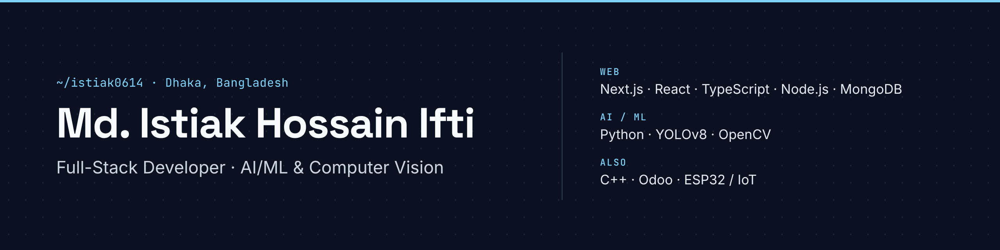

  

<h3 align="center">
  CSE Student · Full-Stack Developer · AI/ML & Computer Vision Enthusiast
</h3>

  I build full-stack web apps with Next.js & TypeScript and real-time computer-vision systems with Python & YOLO.

  
  
  

---

## 👨‍💻 About Me

I'm **Md. Istiak Hossain Ifti**, a Computer Science & Engineering student from **Dhaka, Bangladesh**.
I like building things end to end: from a booking marketplace with authentication and dashboards,
to an IoT camera that detects fruit in real time with a deep-learning model.

- 🌐 **Web:** full-stack apps with Next.js, React, TypeScript, Node.js, Express and MongoDB
- 🤖 **AI/ML:** object detection with YOLOv8, OpenCV and Python
- 🏫 **ERP:** custom Odoo 18 modules in Python
- 💼 **Open to:** software engineering internships and junior roles (web or AI/ML)

---

## 🚀 Featured Projects

| Project | What it is | Tech | Links |
|---|---|---|---|
| **StudioSpace** | Marketplace to book creative studios by the hour, with live availability, double-booking prevention and a host dashboard | Next.js 16 · TypeScript · Express · MongoDB · BetterAuth | [Live](https://studiospace-client-lovat.vercel.app) · [Client](https://github.com/Istiak0614/studiospace-client) · [Server](https://github.com/Istiak0614/studiospace-server) |
| **IoT Fruit Detection** | ESP32-CAM streams images over Wi-Fi to a YOLOv8 model that detects 32 fruit & vegetable classes in real time | Python · YOLOv8 · OpenCV · ESP32 | [Repo](https://github.com/Istiak0614/fruits-detection-esp32-yolov8) |
| **School Management System** | Odoo 18 module with 6 user roles: students, attendance, exams, fees, library and parent/student portals | Python · Odoo 18 · XML · QWeb | [Repo](https://github.com/Istiak0614/school-management-system) |

---

## 🛠️ Tech Stack

**Languages**

  

**Web Development**

  

**AI/ML & IoT**

  
  &nbsp;

**Tools**

  

---

## 📊 GitHub Stats

  
  

---

⭐ Thanks for visiting! Feel free to reach out for collaboration or opportunities.

